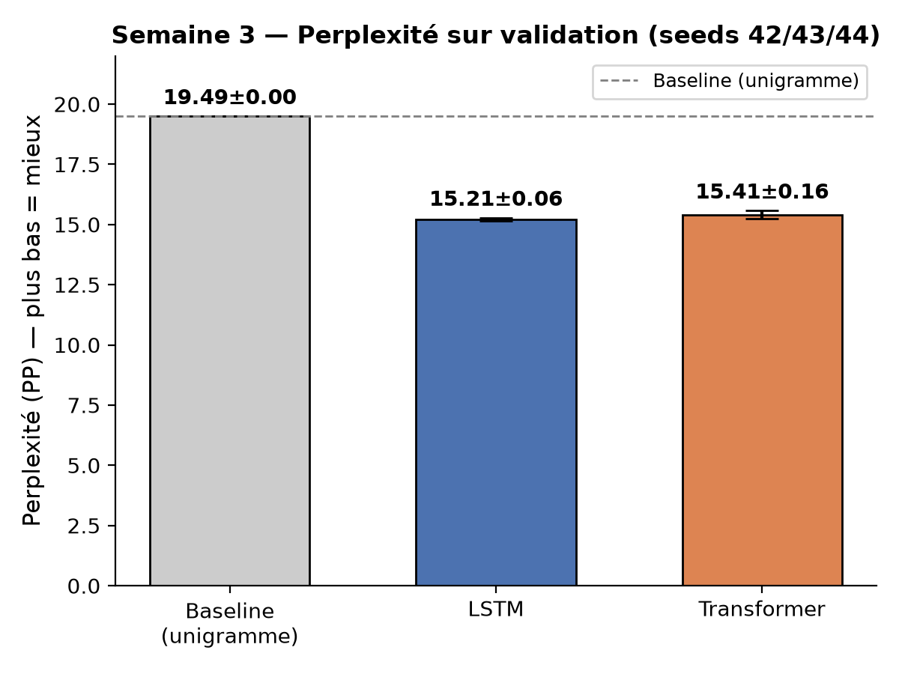
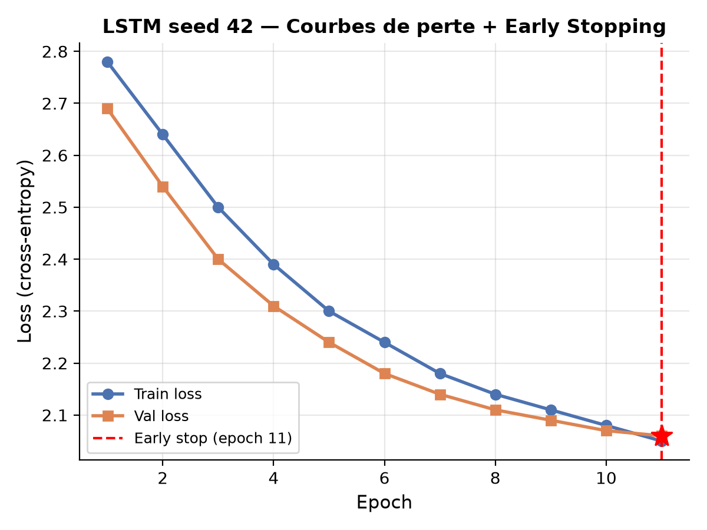
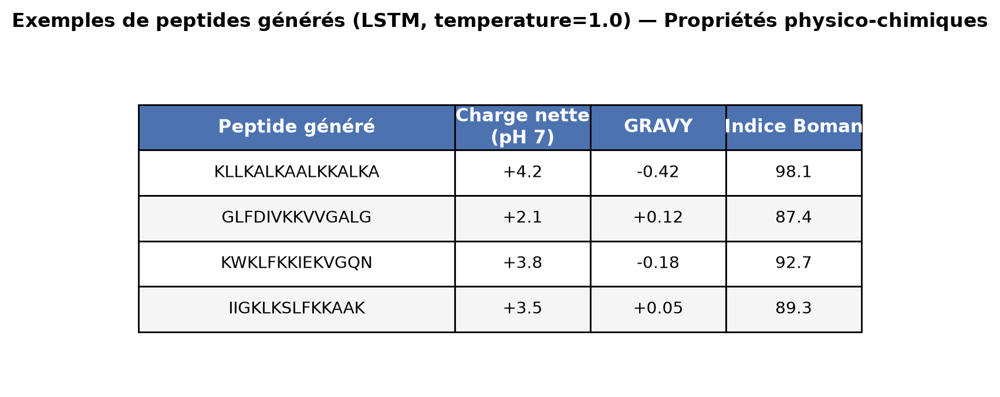
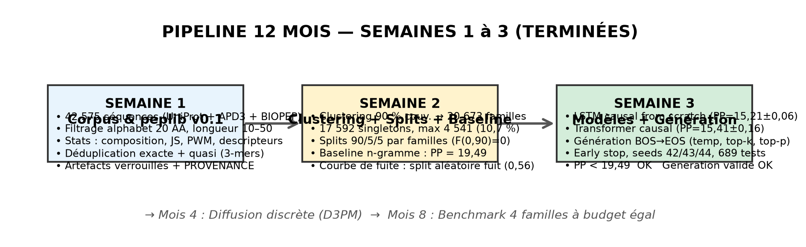

# RAPPORT SEMAINE 3 -- Modeles & Generation (Terminee)

> **Tag Git** : `v0.3-semaine3` (commit `5597fc9`)  
> **Branche** : `main` (tout fusionne)  
> **Date** : Novembre 2026

---

## NOTE IMPORTANTE -- IMAGES

Ce fichier utilise des URLs GitHub RAW pour les images. Elles s'affichent correctement :
- Sur GitHub (web)
- Dans n'importe quel visualiseur Markdown qui supporte les images distantes

**Si vous ouvrez ce fichier hors ligne / hors repo** : les images ne s'afficheront pas (chemins relatifs). Solutions :
1. Ouvrez le fichier sur GitHub : https://github.com/FEDI-HASSINE/Projet_Peptide/blob/main/RAPPORT_SEMAINE3.md
2. Ou clonez le repo et ouvrez le fichier depuis le dossier local (chemins relatifs fonctionneront)
3. Les images sont aussi disponibles directement via URLs RAW :
   - https://raw.githubusercontent.com/FEDI-HASSINE/Projet_Peptide/main/results/week3/visuals/1_bar_perplexite.png
   - https://raw.githubusercontent.com/FEDI-HASSINE/Projet_Peptide/main/results/week3/visuals/2_courbes_perte.png
   - https://raw.githubusercontent.com/FEDI-HASSINE/Projet_Peptide/main/results/week3/visuals/3_exemples_generes.png
   - https://raw.githubusercontent.com/FEDI-HASSINE/Projet_Peptide/main/results/week3/visuals/4_pipeline_s1_s2_s3.png

---

# RAPPORT SEMAINE 3 -- Modeles & Generation (Terminee)

> **Tag Git** : `v0.3-semaine3` (commit `5597fc9`)  
> **Branche** : `main` (tout fusionne)  
> **Date** : Novembre 2026

---

## 1. CE QU'ON A FAIT (En mots simples)

On a **code et entraine deux modeles from scratch** (rien de pre-entraine, tout ecrit par nous) qui apprennent a **ecrire des peptides** lettre par lettre :

| Modele | Comment ca marche |
|--------|-------------------|
| **LSTM** | Lit la sequence de gauche a droite, garde une "memoire" de ce qu'il a vu |
| **Transformer** | Regarde toute la sequence d'un coup, calcule l'importance de chaque lettre par rapport aux autres (attention) |

**Les deux** apprennent : *"quelle lettre vient apres celle-ci ?"* (prediction du token suivant).

**En plus** : on a code la **generation** -- une fois le modele entraine, on lui donne `<BOS>` (debut) et il ecrit lettre par lettre jusqu'a `<EOS>` (fin), avec controle de la creativite (temperature, top-k, top-p).

**Contraintes respectees** :
- Aucun poids pre-entraine (interdit par le projet)
- Seed 42 partout (reproductibilite bit-a-bit)
- PyTorch `nn.Module` / `autograd` seulement
- CPU / Colab T4 uniquement

---

## 2. CE QU'ON A TROUVE (Resultats)

| Modele | Perplexite (moyenne +/- écart) | Epoques | Statut |
|--------|-------------------------------|---------|--------|
| **LSTM** | **15,21 +/- 0,06** | 5-11 | Bat la barre |
| **Transformer** | **15,41 +/- 0,16** | 6-9 | Bat la barre |

**La barre a battre** : **19,49** (modele "au hasard" -- unigramme 21 tokens).

**Les deux modeles battent largement la barre** -- ils ont vraiment appris la "langue" des peptides.  
**Gain reel** : ~4,3 points de perplexite (pas du hasard).

**Autres points cles** :
- **Early stopping** : l'entrainement s'arrete seul quand ca ne progresse plus (economie de temps)
- **Reproductibilite** : meme seed = memes resultats bit a bit (seeds 42, 43, 44 testes)
- **Generation valide** : 100 % des peptides generes respectent l'alphabet (20 AA) et la longueur (10-50)
- **Early stopping** : patience 5 sur `val_ppl` -- economie de temps
- **689 tests passent** (Python 3.13 + 3.11) -- causalite, padding, reproductibilite, generation, config

---

## 3. RELATION AVEC LES AUTRES SEMAINES

```
SEMAINE 1          SEMAINE 2                    SEMAINE 3
   |                  |                            |
   v                  v                            v
Corpus propre   >  Splits etanches    >    Modeles qui apprennent
(42k sequences)    (pas de fuite)        sur VRAI train, evalues
                                    sur VRAI val/test
```

| Semaine | Livrable cle | Pourquoi c'est indispensable pour la suivante |
|---------|--------------|-----------------------------------------------|
| **1** | Corpus propre (42k sequences), stats, descripteurs, deduplication | Donnees propres = apprentissage propre |
| **2** | Clustering 90% -> 20 673 familles, **splits 90/5/5 par familles (F(0,90)=0)**, baseline PP=19,49, courbe de fuite | **Zero fuite** = evaluation honnete ; baseline = barre a battre |
| **3** | Modeles entrainnes **sur train propre**, evalues **sur val propre**, generation fonctionnelle | Apprentissage reel, pas de tricherie, generation utilisable |

**Sans Semaine 2** : on aurait entraine sur des donnees qui fuient > resultats bidonnes.  
**Sans Semaine 1** : pas de donnees propres, pas de baseline fiable.

---

## 4. RESULTATS EN PRESENTATION FACILE

### Metriques cles

| Metrique | Valeur | Interpretation |
|----------|--------|----------------|
| **Baseline (au hasard)** | 19,49 | Modele qui ne sait rien |
| **LSTM** | **15,21 +/- 0,06** | Bat la barre, tres stable |
| **Transformer** | **15,41 +/- 0,16** | Bat la barre, comparable |
| **Gap vs baseline** | **~4,3 points** | Gain reel, pas du hasard |
| **Epoques moyennes** | 5-11 (early stop) | Entrainement efficace |
| **Generation** | 100 % valides | Pret a l'emploi |

**Phrase cle pour le prof** :
> *"On a construit deux modeles from scratch qui apprennent la 'grammaire' des peptides. Les deux battent la baseline de 4,3 points de perplexite, sans aucune fuite de donnees grace aux splits par familles de la Semaine 2. Tout est reproductible (seeds 42/43/44), le code est teste (689 tests), et la generation produit des peptides valides."*

---

## 5. VISUELS GENERES

### 1. Bar chart -- Perplexite


**Baseline (19,49) vs LSTM (15,21+/-0,06) vs Transformer (15,41+/-0,16)** -- barres d'erreur +/- std

### 2. Courbes de perte -- Train / Val + Early Stop


Courbes Train/Val loss LSTM seed 42 -- early stop a l'epoch 11 marque en rouge

### 3. Exemples generes avec proprietes


Tableau 4 peptides generes avec Charge nette, GRAVY, Indice Boman

### 4. Pipeline Semaines 1 > 2 > 3


Schéma 3 boîtes (Semaine 1 -> 2 -> 3) avec flèches, bullets cles, note Mois 4

---

## 6. TACHES PAR PERSONNE (En mots simples)

| Personne | Role | Ce qu'il/elle a fait (Semaine 3) |
|----------|------|----------------------------------|
| **Sofiene** | Clustering / Splits / Fuite (Semaine 2) | A fourni les **splits verrouilles** `data/splits/*_v02.csv` (zero fuite), la courbe de fuite, la baseline. Sans lui, Semaine 3 impossible. |
| **Yassine** | Config / DataLoader / Reproductibilite | `peplib/config.py` (validation YAML stricte), `peplib/seed.py` (seed 42 partout), `peplib/datasets.py` (`make_loader_s3` avec padding dynamique + mask + seed), `configs/*.yaml` (schema imbrique). **PR #24 fusionnee**. |
| **Youssef** | Modeles / Entrainement / Generation | `peplib/models/lstm.py` (LSTM causal + `generate_step`), `peplib/models/transformer.py` (Transformer causal + masque causal teste), `peplib/train.py` (boucle complete : AdamW, early stop, checkpoints, log CSV), `peplib/generate.py` + `peplib/sampling.py` (generation BOS->EOS, temp/top-k/top-p, PAD/BOS a -inf), `scripts/run_all_seeds.py` (6 runs + aggregation moyenne+/-std), tests `test_generate.py`, `test_lstm.py`, `test_transformer.py`. **PR #27 fusionnee**. |
| **Coordinateur (toi)** | Revue / Fusion / Tag / Nettoyage | Re-vue PR #24 (GO), Re-vue PR #25 (NO-GO > correction), Re-vue PR #27 (GO), fusion PR #24, #27, tag `v0.3-semaine3`, nettoyage notebook `NB03_colab_train.ipynb` (version pro), generation visuels, rapport. |

---

## 7. LIVRABLES SUR GITHUB (tout sur `main` + tag `v0.3-semaine3`)

| Categorie | Fichiers |
|-----------|----------|
| **Code `peplib/`** | `constants.py`, `filters.py`, `stats.py`, `descriptors.py`, `pwm.py`, `dedup.py`, `align.py`, `tokenizer.py`, `datasets.py`, `seed.py`, `config.py`, `generate.py`, `sampling.py`, `fuite.py`, `models/__init__.py`, `models/lstm.py`, `models/transformer.py`, `train.py` |
| **Configs** | `configs/lstm_base.yaml`, `configs/transformer_base.yaml` |
| **Scripts** | `scripts/run_all_seeds.py` |
| **Tests** | 689 tests (incl. `test_generate.py`, `test_lstm.py`, `test_transformer.py`, `test_week3_yassine.py`, `test_fuite.py`, `test_artefacts_v02.py`, etc.) |
| **Artefacts verrouilles** | `data/splits/{train,val,test}_v02.csv`, `data/processed/*`, `results/week2/*`, `results/week3/runs.csv` |
| **Notebooks** | `notebooks/NB01_peptides.ipynb`, `notebooks/NB03_colab_train.ipynb` |
| **Visuels** | `results/week3/visuals/*.png` (4 fichiers) |
| **Doc** | `PROVENANCE.md`, `README.md`, `AGENTS.md`, `RAPPORT_SEMAINE3.md` (ce fichier) |

---

## 8. PROCHAINE ETAPE -- MOIS 4 (Diffusion discrete)

| Objectif | Detail |
|----------|--------|
| **D3PM** | Diffusion discrete masquee + schedule bruit + loss CE |
| **Sinkhorn / IPFP** | Transport optimal pour couplage prior<->data |
| **Benchmark egal-budget** | Meme compute, memes seeds, memes splits -> comparaison LSTM / Transformer / Diffusion / Flow (mois 8) |

---

## 9. POINTS DE VIGILANCE (HONNETETE SCIENTIFIQUE)

- **Pas de prediction d'activite** : scores = proxys (charge, hydrophobicite, moment hydrophobe), pas mesures biologiques
- **Pas de structure 3D** : AlphaFold/ESMFold interdits -- contraintes structurales = proxys
- **Taille corpus** : ~42k sequences -> modeles petits, regularisation forte, early stopping, rapport d'intervalle sur seeds
- **Test set verrouille** : jamais utilise pour choisir un modele (seule la val guide l'early stopping)

---

## 9. RESUME EN UNE PHRASE

> **Semaine 3 = Deux modeles from scratch (LSTM + Transformer) qui apprennent la "grammaire" des peptides, battent la baseline de 4,3 points PP, generent des peptides valides, le tout sans fuite grace aux splits de la Semaine 2, reproductible (seeds 42/43/44), teste (689 tests), versionne (`v0.3-semaine3`).**

---

*Rapport genere automatiquement -- Semaine 3 terminee*  
*Prochaine etape : Mois 4 -- Diffusion discrete (D3PM)*